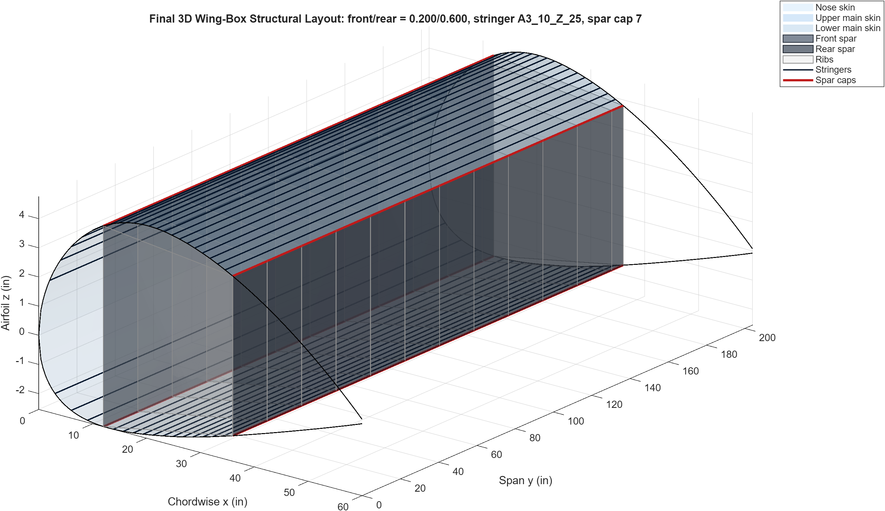
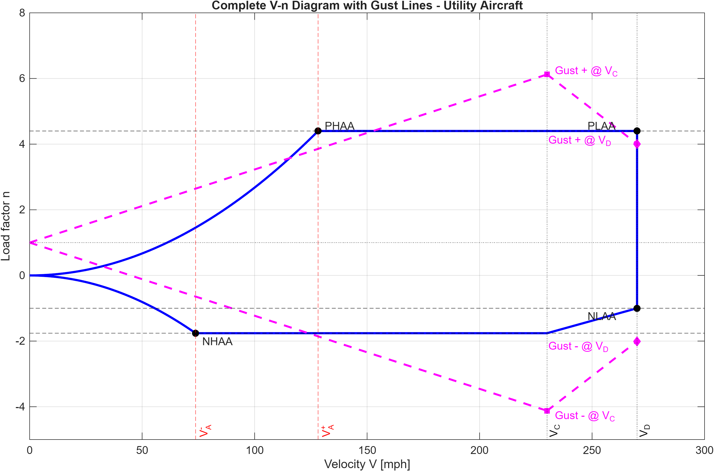
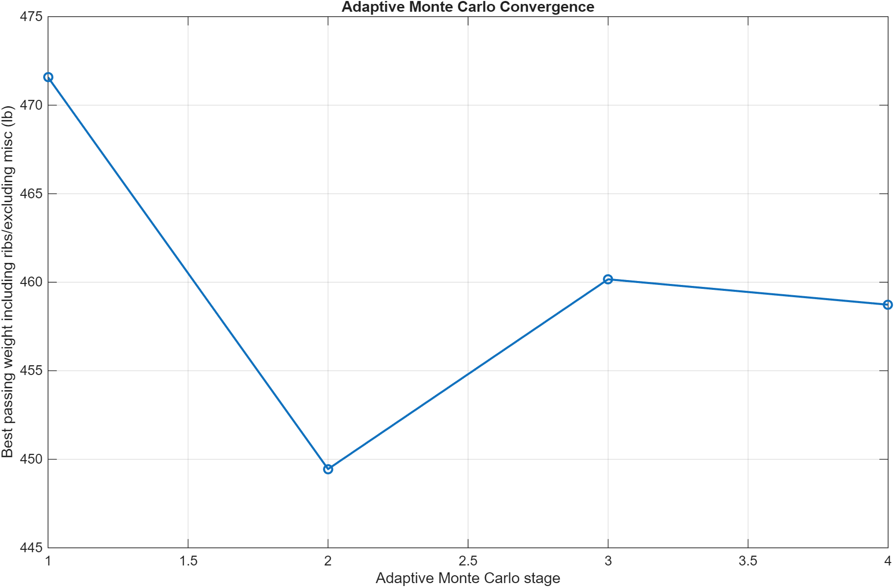
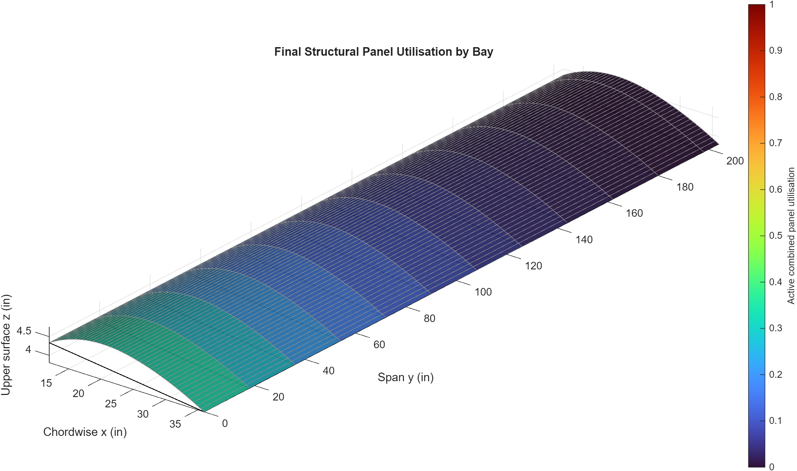

# Wing-Box Structural Design: NACA 2412 Two-Cell Wing Box

Structural sizing and weight optimisation of the two-cell aluminium wing box of a rectangular-wing, utility-category light aircraft. The MATLAB workflow goes from airfoil polar data to flight-envelope loads, spanwise shear, bending and torsion distributions, thin-walled section analysis and failure screening, and closes with a four-stage adaptive Monte Carlo search over 13 design variables.

**Result:** a 449.45 lb wing box (full span, including ribs, excluding miscellaneous detailed-design items), the lightest passing design out of 20,000 evaluated candidates.



## Highlights

- **Loads:** NACA 2412 polar from XFOIL 6.99, finite-wing correction, 14 CFR Part 23 utility-category manoeuvre and gust envelope, and 9 critical load cases distributed along the 204 in semispan and scaled by a 1.5 ultimate factor.
- **Structure:** two-cell section with skins, spar webs, Z-section stringers, T-section spar caps and ribs, idealised into booms. The model recovers bending stress, shear flow (including the shear-centre torsion) and panel shear stress at every rib station.
- **Checks:** von Mises yield, Euler column buckling, divergence, and bay-averaged panel buckling with combined compression, bending and shear ratios.
- **Optimisation:** 4 adaptive stages of 5,000 random designs each, with range refinement around the best 10% of passing designs after every stage. 2,596 of the 20,000 designs pass all checks.

| Final design | Value |
|---|---|
| Spars (front / rear) | 0.20c / 0.60c (60 in chord) |
| Main skin / nose skin | 0.056 in / 0.050 in |
| Spar webs (front / rear) | 0.145 in / 0.100 in |
| Stringers / spar caps | Bruhn A3.10 Z-25 / Bruhn A3.13 T-7 |
| Rib spacing | 18 in (25 ribs full span) |
| Materials | 2024-T3 sheet, 7075-T6 extrusions |
| Weight | 449.45 lb |
| Yield / column / combined panel ratio | 0.9744 / 0.8643 / 0.3372 |
| Divergence ratio (V_div / V_D) | 4.8712 |

| | |
|---|---|
|  |  |
| Flight envelope and critical cases | Best passing weight by stage |



## Report

Full write-up with methodology, equations, results and limitations: [report/wing_box_structural_design_report.pdf](report/wing_box_structural_design_report.pdf). It compiles with pdflatex from `report/` and needs the `siunitx` and `booktabs` packages; run it three times so the table of contents resolves.

## Repository structure

```
code/      MATLAB functions and scripts (all paths are relative to this folder)
data/      inputs: XFOIL polar, materials, stringer and spar-cap sections, critical load cases and spanwise loads
outputs/   figures/ and tables/ of the final run, diagnostics/ of a single-stage comparison run
report/    report source (.tex) and PDF
```

## How to run

Tested with MATLAB R2025b.

1. Open MATLAB in `code/`.
2. `initialLoadGeneration` (optional): regenerates the flight envelope, the 9 critical load cases, `data/critical_load_cases.csv`, `data/spanwise_loads.mat` and the figures in `outputs/figures/load_cases/`.
3. `mainScript`: runs the adaptive Monte Carlo search and exports the tables and figures to `outputs/`. The controls at the top set the run size (`N_PER_STAGE`, default 4 x 5000), `USE_PARALLEL` and the seed (`SEED_MODE`, `SEED`). With `UPDATE_FINAL_ONLY_IF_IMPROVED = true` the stored final design is only replaced if a lighter passing design is found. A full run overwrites the result tables in `outputs/`.
4. `plotFinalWing3DReportFigures` and `plotSupplementaryReportFigures`: rebuild the 3D views, load-case plots, stress plots and summary tables from the stored final design, without re-running the search.

Only base MATLAB is required. The Parallel Computing Toolbox is optional: it is used when `USE_PARALLEL = true`; set `USE_PARALLEL = false` to run the search serially (and reproducibly with a fixed seed).

## License

Released under the MIT License, see [LICENSE](LICENSE).
